<div align="center">

# Biomarx

**A self-hosted observatory for your Apple Health data.**

Upload one `export.zip` and get minute-level sleep actograms, circadian rhythm fits, nocturnal heart physiology, cross-metric correlations, gait trends and single-lead ECG analysis. It all runs on your machine.

[](LICENSE)
[](https://www.python.org/)
[](https://react.dev/)
[](https://duckdb.org/)
[](#run-with-docker)
[](#contributing)

[Quick start](#quick-start) · [Tour](#a-tour-of-the-observatory) · [How it works](#how-it-works) · [API](#api) · [Contributing](#contributing)

<br />

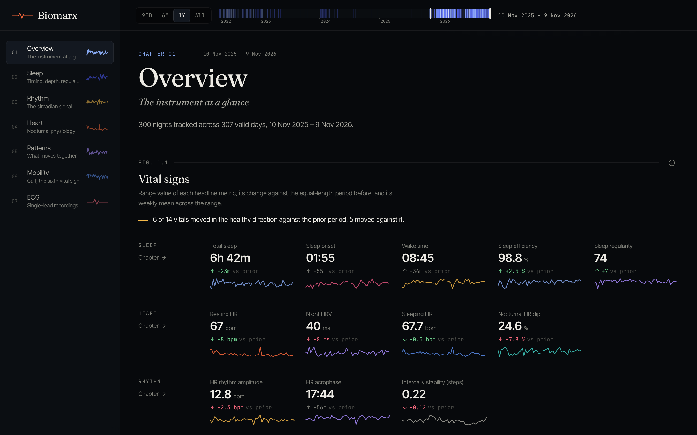

</div>

<br />

## Why Biomarx

The Health app stores years of minute-level data from your watch, but shows only daily summaries. Biomarx reads the raw export and treats it the way a sleep or chronobiology lab would:

- **Every minute counts.** Sleep stages, heart rate and steps keep their native resolution. Each day is a row in an actogram, not one number on a bar chart.
- **Real methods, cited.** Cosinor fits, non-parametric circadian rhythm analysis (IS, IV, RA, M10, L5), the Sleep Regularity Index, MCTQ chronotype, Lomb-Scargle periodograms, Spearman correlations with FDR control, and ECG R-peak detection with HRV. Every figure has a method note.
- **Private by construction.** One process, one embedded database file, no account and no telemetry. The upload is deleted once it has been imported.
- **Fast on years of data.** DuckDB aggregates millions of records in milliseconds, and dense matrices travel as compact binary rasters that render on canvas.

## A tour of the observatory

Biomarx is organized as seven chapters. Every chart responds to one shared date range, which you can set with a preset or by brushing the full-history barcode in the top bar. The range is kept in the URL, so any view can be shared as a link.

### Sleep: timing, depth, regularity

Each night is drawn noon to noon, so no night is split at midnight. Color shows the sleep stage of every minute.

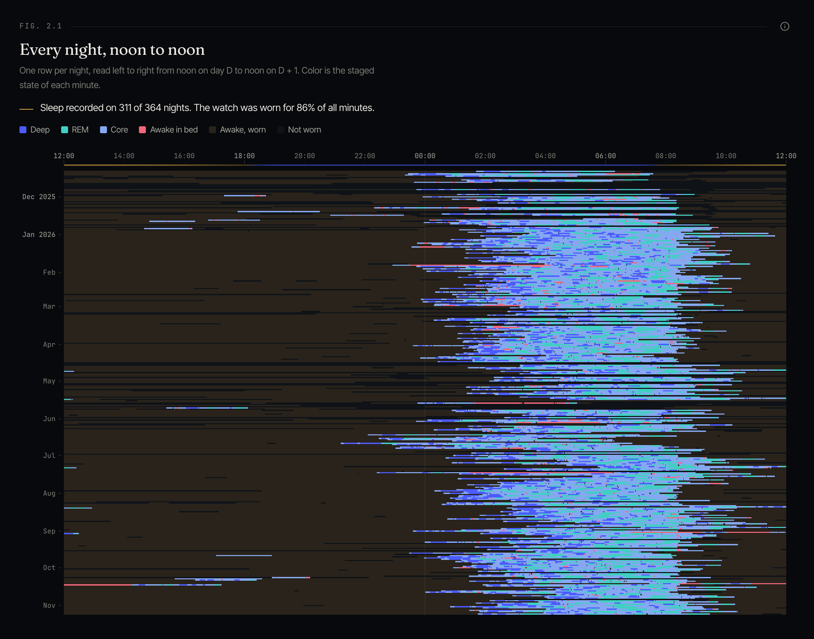

<table>
  <tr>
    <td width="50%">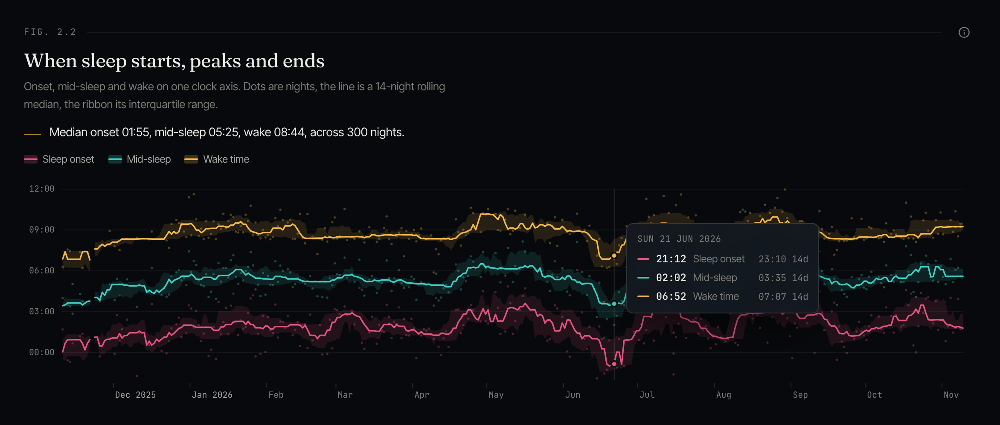</td>
    <td width="50%">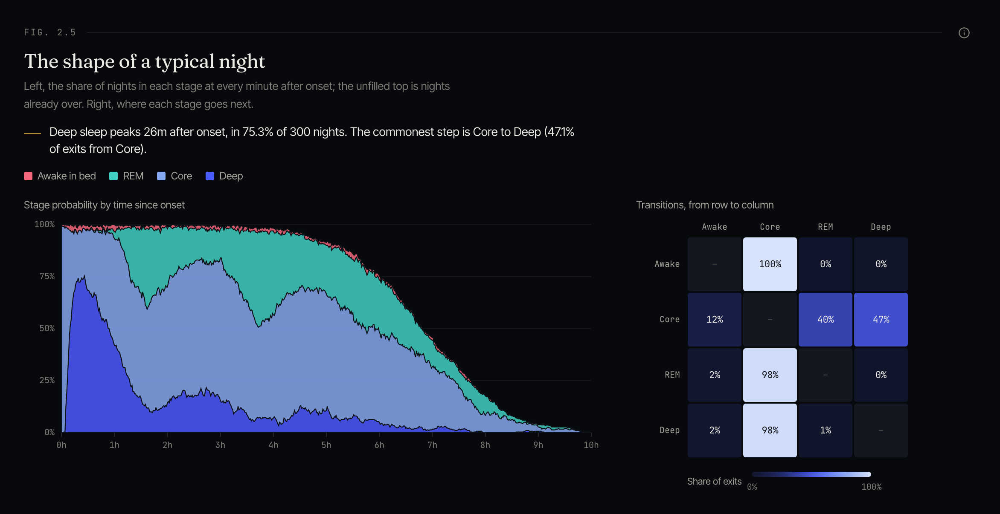</td>
  </tr>
  <tr>
    <td>Onset, mid-sleep and wake on one clock axis. Hovering a day shows that night's values next to the 14-night median.</td>
    <td>The shape of a typical night: the probability of each stage by minute since onset, and how often each stage leads to the next.</td>
  </tr>
</table>

### Rhythm: the circadian signal

<table>
  <tr>
    <td width="50%">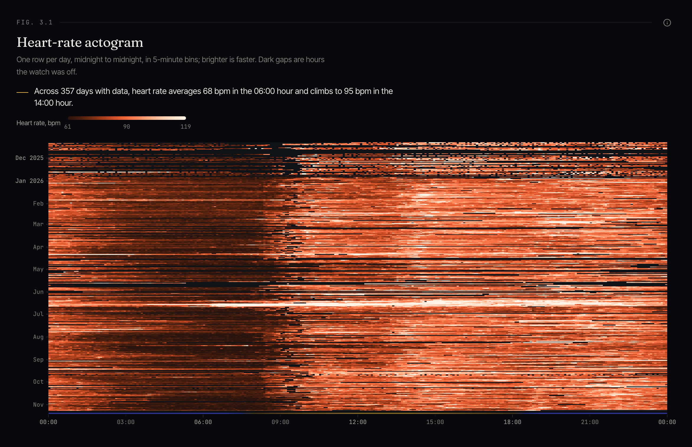</td>
    <td width="50%">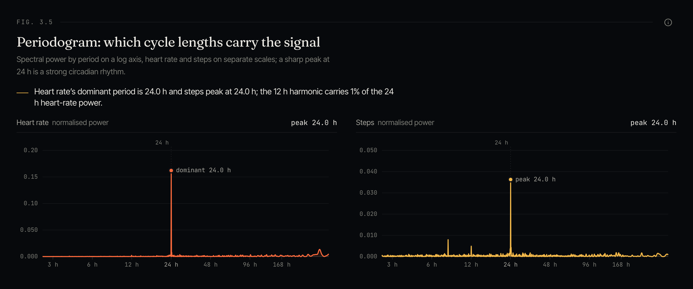</td>
  </tr>
  <tr>
    <td>Heart rate in 5-minute bins for every day of the range. The daytime band and its drift across seasons are visible at a glance.</td>
    <td>The periodogram measures which cycle lengths carry the signal. A strong circadian rhythm is one sharp peak at 24 h.</td>
  </tr>
</table>

### Heart: nocturnal physiology

<table>
  <tr>
    <td width="50%">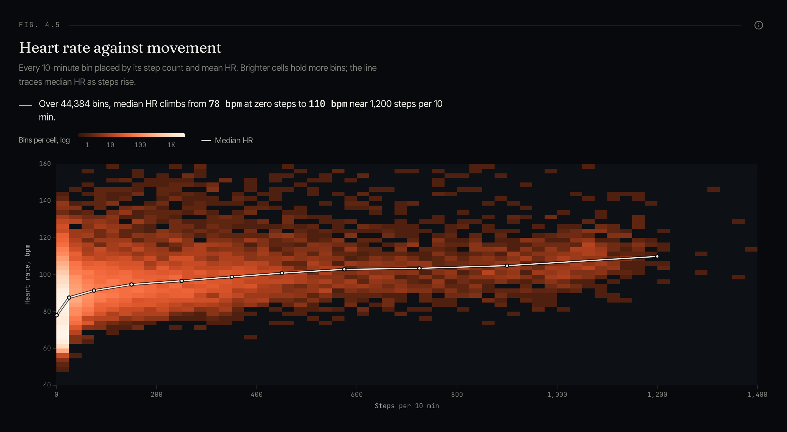</td>
    <td width="50%">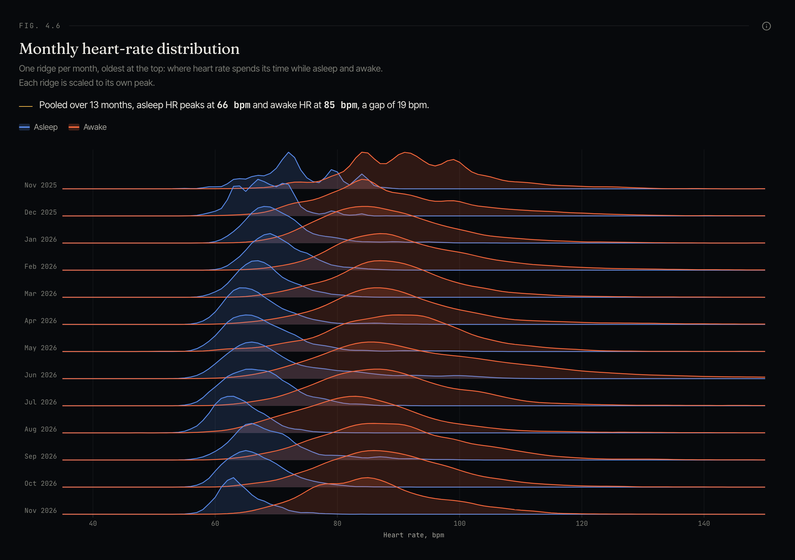</td>
  </tr>
  <tr>
    <td>Heart rate against movement for every 10-minute bin, with the median response curve on top.</td>
    <td>Where heart rate spends its time each month, asleep and awake, as a ridgeline.</td>
  </tr>
</table>

The Heart chapter also tracks resting and sleeping heart rate, night HRV, the nocturnal dip, SpO2 and respiratory rate.

### Patterns: what moves together

Every pair of daily metrics, ranked by Spearman correlation and ordered by clustering. Dots mark pairs that survive Benjamini-Hochberg FDR. Click any cell to plot that pair day by day.

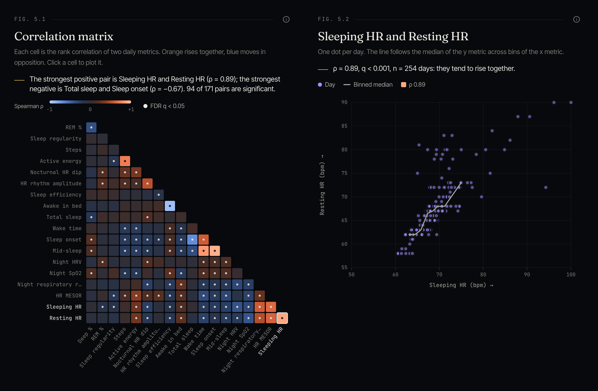

### ECG: single-lead recordings

Every recording from the watch is drawn on ECG paper with detected R-peaks. The chapter also has an RR tachogram, a Poincaré plot with SD1 and SD2, and an ensemble of every beat.

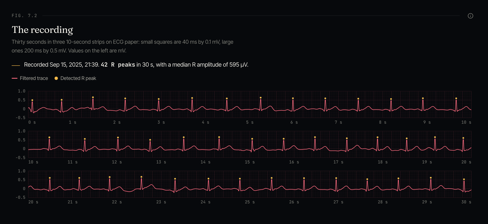

### Mobility: gait, the sixth vital sign

Walking speed, step length, double-support time and asymmetry, plus the shape of an ordinary week and day.

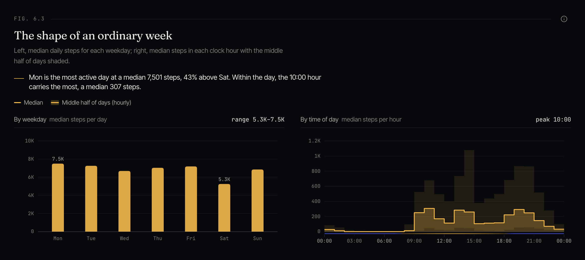

> The screenshots show one person's real export: about 1,600 days, 2.6 million records and 569 nights.

## Quick start

### Requirements

- Python 3.13 with [uv](https://docs.astral.sh/uv/)
- Node.js 22 or later with [pnpm](https://pnpm.io/)

### Run in development

```bash
git clone https://github.com/vasu2912/biomarx.git
cd biomarx
make install
make dev            # API on 127.0.0.1:4174, UI on 127.0.0.1:5173
```

Open http://127.0.0.1:5173 and drop in your `export.zip`. To get one on iPhone, open the Health app, tap your profile picture, then **Export All Health Data**.

You can also import from disk:

```bash
make ingest FILE=~/Downloads/export.zip
```

### Run with Docker

```bash
docker build -t biomarx .
docker run -p 127.0.0.1:4174:4174 -v biomarx-data:/data biomarx
```

One image serves the UI and the API on port 4174. Imported data lives in the `/data` volume.

### Build and run without Docker

```bash
make build
cd backend && uv run biomarx serve     # serves the built UI and the API on :4174
```

## How it works

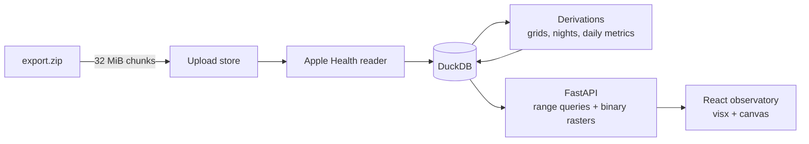

1. **Upload.** The browser streams the export in 32 MiB chunks. That stays under Cloudflare's 100 MB request limit, so Biomarx works behind a tunnel.
2. **Ingest.** A background job parses every `<Record>`, `<Workout>` and ECG in local wall-clock time. That is the right clock for circadian analysis.
3. **Derive.** The pipeline builds minute grids for heart rate, sleep stage, wear and steps, then nights, daily metrics, cosinor and NPCRA windows, and SRI. An import replaces the dataset atomically, so re-importing a newer export converges to the same state as a fresh one.
4. **Serve.** The API answers range queries in columnar JSON, with one array of days and one array per metric. Dense matrices go out as little-endian binary rasters.
5. **Draw.** The client keeps each response in a range-keyed cache and draws with visx, d3 and canvas.

### Project layout

```
backend/            Python 3.13, uv, FastAPI, DuckDB, NumPy, SciPy
  src/biomarx/
    core/           pure domain: metric registry, ports, analysis math, services
    impl/           adapters: Apple Health reader, DuckDB store, uploads, job runner
    api/            FastAPI app, routes, response schemas, static hosting
    cli.py          biomarx ingest | serve | openapi
frontend/           React 19, Vite, TypeScript, Tailwind v4, Radix, visx
  src/
    app/            providers, router, shell, range control
    core/           types generated from OpenAPI, stats, formatting
    infra/          API client, raster decoding, query hooks
    ui/             design tokens, primitives, chart kit
    features/       one folder per chapter
docs/               architecture notes and screenshots
```

Dependencies point inward, `api -> core <- impl`. `core` imports nothing from FastAPI or the adapters. [`docs/architecture.md`](docs/architecture.md) covers the storage model, the domain rules and the full API contract.

## API

All routes live under `/api`. Ranges are given as `start` and `end` ISO dates, with `end` exclusive. When they are omitted, the range defaults to the last 365 days of the dataset. The OpenAPI schema is served at `/docs`.

| Route | Returns |
|---|---|
| `GET /status` | the loaded dataset and any active import |
| `GET /metrics` | the metric registry: label, unit, group, direction, description |
| `POST /imports`, `PUT /imports/{id}/chunks/{n}`, `POST /imports/{id}/commit` | chunked upload, then start the pipeline |
| `GET /imports/{id}` | import state, phase, progress and message |
| `GET /summary`, `/daily`, `/nights` | headline numbers and columnar series |
| `GET /rasters/{sleep,hr5,steps10}` | binary day by time-of-day matrices |
| `GET /analysis/{architecture,chronotype,periodogram,correlation,state,hr-activity}` | precomputed analyses for the range |
| `GET /ecg`, `GET /ecg/{id}` | recordings, filtered trace, R-peaks, RR intervals, Poincaré, ensemble beat |

## Configuration

| Variable | Default | Purpose |
|---|---|---|
| `BIOMARX_DATA_DIR` | `./data` | DuckDB file and temporary uploads |
| `BIOMARX_STATIC_DIR` | `./frontend/dist` | built UI |
| `BIOMARX_HOST` | `127.0.0.1` | bind address |
| `BIOMARX_PORT` | `4174` | port |

## Privacy and security

- Your data never leaves the machine. There are no third-party requests, no analytics and no accounts.
- The raw upload is deleted after import. Only the DuckDB file in `BIOMARX_DATA_DIR` remains.
- `.gitignore` and `.dockerignore` keep exports, databases and screenshots of your data out of git and out of images.
- Biomarx has no authentication. Keep it on a trusted machine, or put it behind an authenticating proxy such as Cloudflare Access before you expose it.

## Development

```bash
make test           # backend unit and end-to-end tests, frontend lint and build
make lint           # ruff and oxlint
make types          # regenerate frontend types from the OpenAPI schema
make parity VIZ=path/to/viz.py   # reproduce the reference analysis within tolerances
```

Browser checks run against a live dev server:

```bash
cd frontend
node e2e/smoke.mjs          # every route: no console errors, charts drawn, full-page screenshots
node e2e/readme-shots.mjs   # regenerate the screenshots in this README
```

## Roadmap

- [ ] Multiple profiles, one DuckDB file each
- [ ] Lab-report (PDF) import, carried over from the first prototype
- [ ] A smaller Docker image
- [ ] Export of derived tables to CSV and Parquet

## Contributing

Issues and pull requests are welcome. Before you open a PR:

1. Run `make test` and `node frontend/e2e/smoke.mjs`, and make sure both pass.
2. Keep `core/` free of framework and adapter imports.
3. Draw new charts with the existing kit in `frontend/src/ui/charts`. Give each one a hover layer, one y-axis, and a legend when it has two or more series.
4. Never commit real health data. Test fixtures must be synthetic.

## Acknowledgements

The analyses follow published methods, including Phillips et al. (2017) for the Sleep Regularity Index, Roenneberg et al. (2003) for MCTQ chronotype, and Van Someren et al. (1999) for non-parametric circadian rhythm analysis. Biomarx is not affiliated with Apple. It is not a medical device and does not give medical advice.

## License

[MIT](LICENSE) © 2026 Vasu Kandagatla
